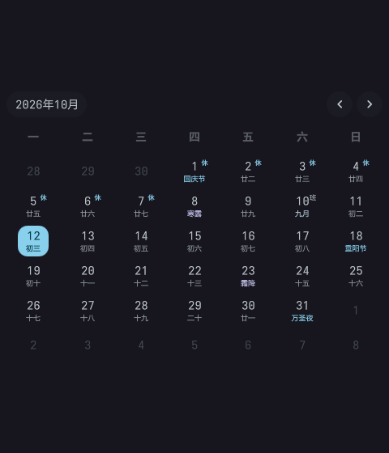
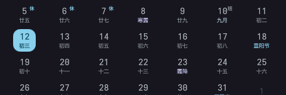

# clavis-lunar-calendar

> [Clavis Shell](https://github.com/StatIndet/quickshell)（niri + Quickshell）侧边栏「信息」页日历的
> **农历 / 节气 / 法定节假日休班角标**：每个日期格两行（日号 + 农历日/节气/节日）、
> 右上角 休/班 角标，悬停看当天详情。全部本地计算，离线可用。

<p align="center">
  
</p>

<p align="center">
  
</p>

<p align="center"><sub>截图拍摄于 2026-10-12（无头 cage 渲染，纯净上游 2026.9.25 + 本组件补丁），原样呈现当月。</sub></p>

## 功能

- **第二行**：优先显示节日（农历 > 公历）→ 节气 → 初一（月名）→ 农历日；
  「世界…日」这类纪念日噪声已过滤，超长节日名自动省略
- **休 / 班角标**：法定节假日显示「休」，调休上班显示「班」；普通周末与数据表覆盖范围之外的
  年月不显示角标
- **悬停详情**（tooltip）：公历日期 + 星期、农历月日 + 干支年、节气、节日、假期名与「放假 / 调休上班」
- **跨零点自动跟随**：翻页到别的月份后再回到当月、或日期跨过零点，「今天」高亮与农历自动刷新
- **跟随主题**：日号取 `Typography.bodyMedium`，打了全局字号补丁的环境自动跟随；颜色取
  Clavis 主题 token（节日 primary / 节气 tertiary / 初一月名 secondary），明暗主题自适应
- 零配置文件、零缓存文件、零网络请求

## 依赖

| 依赖 | 必需性 | 说明 |
|---|---|---|
| Clavis Shell（Quickshell） | 必需 | 本组件是它的 overlay 扩展 |
| `bash` `python` | 必需 | 安装引擎（`python3` 标准库，无第三方包） |
| `qt6-declarative` | 可选（推荐） | 安装时的 `qmllint` / `qmlformat` 语法门禁与冒烟测试 |
| `rsync` | 可选 | overlay 同步更快 |
| `curl` `jq` | 可选 | 只读数据检查 `./install.sh --check-data`（定时器用） |

## 安装

**方式一：git clone**

```bash
git clone https://github.com/LumiACGN/clavis-lunar-calendar.git
cd clavis-lunar-calendar
./install.sh --dry-run   # 先看会发生什么（不写任何文件、不停 shell）
./install.sh             # 正式安装（自动停/起 clavis-shell）
```

**方式二：AUR**

```bash
paru -S clavis-lunar-calendar
clavis-lunar-calendar-overlay install --dry-run   # 可选：先预览
clavis-lunar-calendar-overlay install             # 正式安装
```

（AUR 包元数据已备好（`packaging/aur/clavis-lunar-calendar/`），首次提交上架前请用 git clone 方式。）

安装采用 **overlay** 方式：把 Clavis 源码树镜像到 `~/.config/quickshell/clavis/`，
再叠加锚点补丁与数据层，**不触碰 `/etc`**（那是包管理器的地盘，升级会被覆盖）。

安装后（Clavis 升级 / 日常维护）：

```bash
./install.sh --sync      # 重新对齐（失败会保留旧 overlay 并恢复运行，不会炸）
./install.sh --verify     # 逐组件检查补丁/载荷 + 孤儿标记报告（附带本仓定时器路径检查）
./install.sh --list       # 列出已注册组件（多组件共存时看谁在、重放顺序如何）
./install.sh --uninstall  # 只移除本组件（其它组件不受影响）；--uninstall --all 整体拆除
./install.sh --forget <kit-id>    # 从注册表摘除某组件（不碰 overlay；仓库被删/搬走时的逃生舱）
./install.sh --check-data         # 只读检查上游农历库/节假日数据是否有新版（需 curl + jq）
./install.sh --with-timer         # 安装「每年 11~12 月只读检查」用户定时器（默认不装）
```

AUR 安装用 `clavis-lunar-calendar-overlay <install|sync|verify|uninstall|list|forget>`
（同一引擎，参数一致）；数据检查是 `clavis-lunar-calendar-check-data`。

> ⚠️ Clavis 尚无插件系统，本组件通过"锚点补丁"接入，Clavis 大版本升级后锚点可能漂移
> ——`--sync` 会明确报错并给出修复指引，见 [docs/COMPATIBILITY.md](docs/COMPATIBILITY.md)。

## 本组件不做什么

1. **运行时不联网、不创建 `Process`、不执行任何系统命令**。QML 侧是纯展示组件，符合上游 Clavis
   `AGENTS.md` 的要求（「展示组件不得创建 `Process` 或执行命令」）；`curl`/`jq` 只出现在你
   手动执行（或定时器显式启用）的**只读检查脚本**里。
2. **农历 / 节气 / 传统节日 / 干支全部本地计算**：内置 [6tail/lunar-javascript](https://github.com/6tail/lunar-javascript)
   1.7.7（MIT，逐字节 vendored 在 `lunar/vendor/`），无任何在线 API、无缓存文件。
3. **法定节假日 / 调休不是算出来的**：它是库内置的数据表（一份编码后的记录），
   当前版本的数据**截止 2026-10-10**。次年安排公布后需要更新一次数据层（步骤见
   [docs/DATA.md](docs/DATA.md)）；数据表覆盖范围之外的年月**不显示休/班角标**，其余功能正常。
4. **没有配置项、不写 `/etc`、没有后端脚本**：不生成配置文件、不改系统目录，
   只往 overlay 目录镜像与写用户级状态/备份（`~/.local/state/clavis-overlay/`）。

## 与其它 clavis 组件共存

同机的多个 clavis 组件共享同一个 overlay（`~/.config/quickshell/clavis/`）：
引擎按各组件在 `patches/manifest.json` 里声明的 `order` 重放**全部**已注册组件
（本组件 `order` 20），**谁 `--sync` 谁负责把大家都重新打上**，不会互相覆盖。
`./install.sh --verify` 末尾会报告「孤儿标记」（overlay 里存在但不属于任何已注册组件的补丁标记）。

（[clavis-ai-usage](https://github.com/LumiACGN/clavis-ai-usage) 是同一引擎的另一组件，可同时安装。）

## 许可证

GPL-3.0-or-later（见 [LICENSE](LICENSE)）。

本组件是 Clavis Shell 的衍生作品（补丁内容包含其经修改的代码片段），因此整体以
GPL-3.0-or-later 发布；vendored 的 lunar-javascript 是 MIT 许可（原文见
[NOTICE](NOTICE) 与 `qml/lunar-javascript-MIT.txt`）。

## 文档

| 文档 | 内容 |
|---|---|
| [docs/DATA.md](docs/DATA.md) | 数据层构成、数据边界、**年度更新步骤** |
| [docs/ARCHITECTURE.md](docs/ARCHITECTURE.md) | 仓库结构、补丁落点、字号策略、数据流 |
| [docs/COMPATIBILITY.md](docs/COMPATIBILITY.md) | 兼容基线、锚点漂移处理、退休路径 |
| [docs/TROUBLESHOOTING.md](docs/TROUBLESHOOTING.md) | 常见问题（sync 失败 / 门禁 / 定时器 / 多组件） |
| [CONTRIBUTING.md](CONTRIBUTING.md) | 开发流程、锚点维护、发布流程 |
